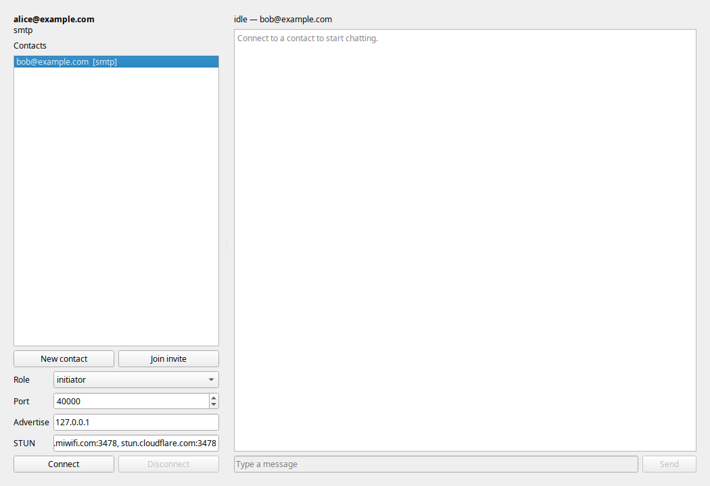
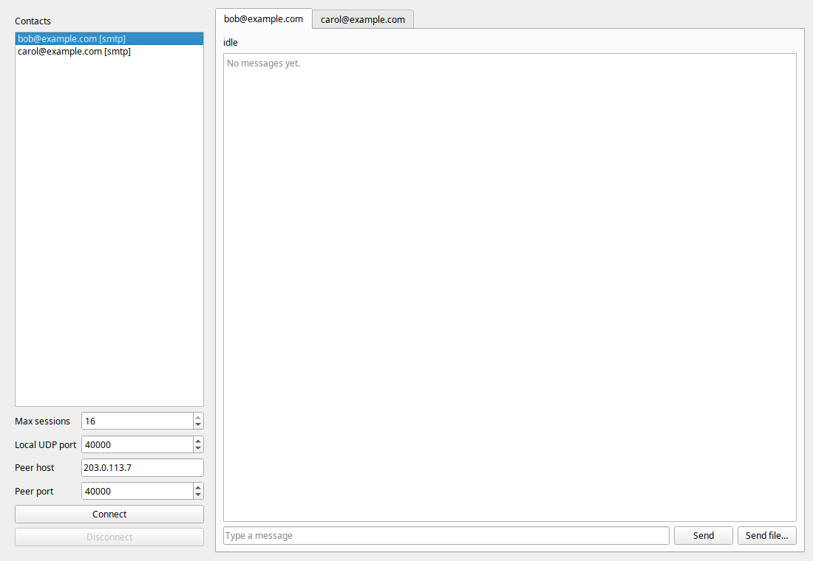

# StrayPigeon

> **Email-signaled, end-to-end encrypted P2P chat.**
> 一只迷途的信鸽，也总能找到同伴。


旧单会话窗口（STUN/UDP 路径）：



新的多会话窗口（QUIC 路径，实验性）：



**StrayPigeon** 是一个完全开源的点对点聊天应用。它用你已有的邮箱（SMTP/IMAP）做信令，不依赖自建信令服务器；数据面有两条路径：

- **Legacy 路径**：STUN + UDP 打洞，X25519 + HKDF + ChaCha20-Poly1305；旧主窗口使用；
- **QUIC 路径（实验性）**：aioquic、单 UDP 端口、最多 16 个会话、文件传输、MailRouter；新的 **Multi-session** 窗口使用。

> 注意：这是一个研究/毕业设计原型，**尚未经过安全审计**。  
> **QUIC 路径目前仍是实验性**：本地/offscreen 测试通过，但真实 163/126 端到端尚未验收；TLS 证书校验当前为 `CERT_NONE`，证书指纹固定（fingerprint pinning）还没实现，不能当作生产级端到端认证。

## 为什么叫 StrayPigeon

邮件是信鸽：它只负责把“地址”和“公钥/候选”送到对方手里。真正的消息不经过邮件服务器，而是两只鸽子在 NAT 之间直接对上暗号。

项目原名 `email-p2p`。代码里的 vault 目录仍保留 `email-p2p`，是为了兼容已有数据。

## 两条数据路径

| | Legacy 路径 | QUIC 路径（实验性） |
|---|---|---|
| 入口 | 旧主窗口 `python -m p2p.gui` | 主窗口里的 **Multi-session…** |
| 传输 | STUN + UDP 打洞 | aioquic，单 UDP 端口 |
| NAT 穿透 | STUN + UDP 打洞 | **未实现**：当前只支持直接可达的 host:port |
| 并发 | 单会话 | 最多 16 个会话 |
| 加密 | X25519 + HKDF + ChaCha20-Poly1305 | QUIC TLS（当前 `CERT_NONE`，待证书指纹固定） |
| 文件 | 无 | 分块、`.part`、续传、SHA-256、进度 |
| 信令 | 旧 `Session` 直接收发 | 单 IMAP `MailRouter` + GUI 自动 connect |
| 实网状态 | 之前 163/126 `CONNECTED` | **真实 163/126 尚未验收** |

## 特性

- **邮箱即信令**：不需要额外的信令服务器；SMTP 或 IMAP 都能送候选。
- **Contact 实例**：每个对话一个 contact，拥有独立 PSK、role、local_port；邀请码里自动携带 role，加入方保存相反 role。
- **多联系人**：一个 identity 可以保存多个 contact；GUI 里点选后连接。
- **QUIC 多会话**：单 UDP 监听端口、最多 16 个并发会话、第 17 个拒绝；并发上限 1–16 可调。
- **大文件传输**：1–4 MiB 分块，接收端写 `.part`，`.part.json` 支持续传，完成后 SHA-256 校验再原子改名。
- **MailRouter**：每个 identity 一个 IMAP poller，按 `p2p1/<sid>/<seq>` 路由；未绑定 sid 用各 contact PSK 探测；163 风格 `SEARCH ALL` 回退。
- **加密 vault**：scrypt + ChaCha20-Poly1305，保存邮箱授权码和 PSK；口令不落盘。
- **GUI + CLI**：PyQt6 桌面端；命令行仍可用于脚本/服务器环境。
- **跨平台**：Windows / Linux。
- **默认不限速**；消息不持久化、不做离线补发（设计选择）。

## 什么是 `p2p1`

有两个不同的东西：

1. **邀请码**：`p2p1:<Base32>`，包含双方邮箱、本次对话 PSK、role；用于 New contact / Join invite。**它不进邮件**，仍然复制粘贴、带外发送。
2. **信令邮件主题**：`p2p1/<sid>/<seq>`，邮件正文是 PSK 加密后的 AEAD envelope。邮件服务商能看到主题、sid/seq、双方地址和时间，但看不到 PSK/邀请码；MailRouter 只读取这些信令邮件，不发送邀请码。

## 它是怎么工作的

### Legacy 路径

```text
A ── SMTP/IMAP: 候选 + 公钥（PSK 封装） ──▶ B
      STUN → 公网映射 / NAT 分类
      UDP 打洞 + keepalive
      X25519 → HKDF → ChaCha20-Poly1305
```

1. 双方各自配置身份，不交换 peer；
2. 发起方生成邀请码，带外发给对方；
3. 双方通过邮箱交换候选、NAT 类型和临时公钥；
4. STUN + UDP 打洞直连；
5. X25519 协商会话密钥，聊天帧 AEAD 加密；
6. 15 秒 keepalive 维持 NAT 映射。

### QUIC 路径

```text
邀请码 p2p1:...  ──复制粘贴/带外──▶  对方 Join
       │
       ├─ MailRouter 轮询 p2p1/<sid>/<seq>
       ├─ CANDIDATE → peer host/port → GUI 自动 connect
       └─ QUIC 单 UDP 端口：chat streams + file streams
```

- 邀请码仍然是带外复制粘贴；
- 信令邮件沿用原有的 `p2p1/<sid>/<seq>` 主题；
- `MailRouter` 负责单 IMAP、sid 路由、未绑定 PSK 探测、163 回退；
- GUI 收到 CANDIDATE 后更新 contact 的 peer host/port，并自动 `QuicController.connect()`；
- 文件走 QUIC stream，不走邮件。

> **重要：QUIC 本身不解决 NAT 穿透。** 当前 QUIC 路径没有 STUN、没有 UDP 打洞、也没有从新窗口发送 CANDIDATE；`QuicController` 只是 `serve` + `connect` 到一个已知 host:port。它目前只适用于同一 LAN、公网 IP、端口映射等可直接到达的场景；家庭 NAT 后不能保证连通。

## 快速开始

### 0. 准备

- Python 3.10+
- 两个支持 IMAP/SMTP 的邮箱（推荐不同提供商，例如 126 ↔ 163）
- 各自的邮箱授权码/应用专用密码（不是登录密码）
- 能访问 UDP 外网；对称 NAT（APDM）目前没有中继兜底
- QUIC 路径需要 `aioquic` 和 `qasync`（已包含在 `requirements-gui.txt`）

### 1. 安装

Linux / Arch（系统 Python 受 PEP 668 保护，用 venv）：

```bash
git clone https://github.com/B4r1m0ss/StrayPigeon.git
cd StrayPigeon
python3 -m venv --system-site-packages .venv
.venv/bin/pip install -r requirements-gui.txt
.venv/bin/python -m p2p.gui
```

Windows：

```powershell
git clone https://github.com/B4r1m0ss/StrayPigeon.git
cd StrayPigeon
py -3 -m pip install -r requirements-gui.txt
py -3 -m p2p.gui
```

只跑 CLI：

```bash
python3 -m pip install -r requirements.txt
```

### 2. 创建身份（不包含 peer）

```bash
python3 scripts/setup.py --mode smtp
```

只填写**你自己的**邮箱、IMAP/SMTP 主机、授权码和 vault 口令。这一步不会询问对话对象。

### 3. 创建/加入对话

```bash
python3 scripts/contact.py new --peer bob@example.com
# 默认本端 initiator；也可以显式 --role responder
# 邀请码里会带 role；加入方自动存相反 role
# 把打印出来的 p2p1: 邀请码带外发给对方

python3 scripts/contact.py join "p2p1:..."
python3 scripts/contact.py list
```

一个 identity 可以有多个 contact；每个 contact 有自己的 PSK、role、local_port。

### 4. GUI

```bash
python3 -m p2p.gui
# Windows: py -3 -m p2p.gui
```

#### 4.1 旧主窗口 / Legacy 路径

1. 首次启动点 **Create identity…**，进入 Setup 向导；向导只创建 identity，不问 peer；
2. 解锁 vault；
3. 在左侧选择 contact；没有就点 **New contact** / **Join invite**；
4. 设置 role、port、advertise、STUN；
5. 点 **Connect**；
6. 连上后输入消息，Enter 或 **Send**；**Disconnect** 断开。

- 连接过程显示 `bound → peer ready → punching`，punching 有最多 300 秒进度条；
- **Allow UDP** 放行本机当前 UDP 端口（Windows UAC；Linux 显示 ufw/firewalld/nft 命令）；
- **Vault…** 支持修改口令、清除/重置、锁定。

> SMTP TLS：**465 = 隐式 TLS（STARTTLS 不勾）**；**587 = STARTTLS（勾选）**。  
> 163 / 126 的 SMTP 用 465，STARTTLS 保持关闭。

两台机器的常用组合：

```text
机器 A（发起方）: role=initiator, port=40000, advertise=127.0.0.1
机器 B（响应方）: role=responder, port=40000, advertise=127.0.0.1
STUN: stun.miwifi.com:3478, stun.cloudflare.com:3478
```

同一局域网可以把 `advertise` 换成各自的 LAN IP。

#### 4.2 Multi-session… / QUIC 路径（实验性）

主窗口点 **Multi-session…** 打开新窗口：

- 左侧 contact 列表，右侧每个 contact 一个 tab；
- **Max sessions**：1–16；
- **Local UDP port**：QUIC 监听端口；
- **Peer host / Peer port**：手动连接地址（MailRouter 收到 CANDIDATE 时会自动填充并连接）；
- **Connect / Disconnect**、**Send**、**Send file…**；
- 文件显示进度条；接收端文件落在 `state/received/`。

注意：

- 目前 `MultiSessionWindow` 默认 **auto_connect=True**；双方都启动 QUIC server 时，role/重复连接还没有真实双端验收；
- 建议真实测试时先只让一边 auto-connect，确认只有一条 QUIC 连接；
- 真实 MailRouter + IMAP 自动连接目前只通过 fake router 测试，真实 163/126 未验收。

### 5. CLI

```bash
python3 scripts/run_vault.py --vault ~/.config/email-p2p/vault.json \
  --contact bob@example.com --role initiator --port 40000
```

只有一个 contact 时可以省略 `--contact`。Windows 的 vault 路径是 `%APPDATA%\email-p2p\vault.json`。

## 当前状态

- **77 个单元测试通过**；
- 系统 Python 没装 aioquic 时：77 tests，9 skipped；
- **Legacy 路径**：同机加密 demo `PASS`；之前真实 163（Windows）↔ 126（Linux）跨提供商 SMTP 加密聊天 `CONNECTED`（pre-QUIC）；
- **QUIC 路径**：16 会话、16 × 1 MB 文件、4 MB 单文件、断点续传、SHA-256、MailRouter、Qt controller、多会话窗口 offscreen 测试通过；
- **QUIC 真实 163/126 端到端：尚未验收**；且当前缺 NAT 穿透/候选发送；
- **尚未完成**：真实 163/126 QUIC 验收、证书指纹固定、100 GB 级文件实测、PyInstaller GUI exe/安装包、托盘/通知、自动重连；
- **未做安全审计**。

## 安全模型

- **PSK**：每个 contact 独立 32 字节，随机生成；编码在邀请码里，带外传递；不经过邮箱。
- **邀请码**：含双方邮箱/共享邮箱、PSK、role、checksum；不是身份口令，但拿到邀请码的人可以加入该对话。
- **vault**：邮箱授权码和 PSK 用 `scrypt(n=2^15, r=8, p=1)` + `ChaCha20-Poly1305` 加密；口令不保存。
- **Legacy 数据面**：X25519 临时密钥 → HKDF → ChaCha20-Poly1305；序号防重放；心跳不携带聊天内容。
- **QUIC 数据面**：QUIC TLS 加密；**当前客户端 `CERT_NONE`，没有证书指纹固定**，所以只能算“实验性加密通道”，不能算生产级端到端认证。后续需要把服务器证书 fingerprint 写入邀请码/contact 并强制校验。
- **信令**：IMAP 993 / SMTP 465 走 TLS；邮件服务商能看到 `p2p1/<sid>/<seq>` 元数据，但看不到 PSK/聊天内容；邀请码不经过邮件。
- **没有中继**：没有 TURN/relay；双方都是对称 NAT 时 Legacy 路径会返回 `E_SYMMETRIC_NAT`。

## 已知限制

- **QUIC 路径没有 NAT 穿透**：没有 STUN、没有 UDP 打洞、没有从新窗口发送 CANDIDATE；只能直连已知 host:port（LAN/公网/端口映射）。家庭 NAT 后不能保证连通。
- **QUIC 路径未真实双端验收**：真实 163/126 的 MailRouter、自动 connect、role/重复连接、防火墙和文件速度都还没确认。
- **QUIC TLS 证书未固定**：当前 `CERT_NONE`，存在 MITM 风险；生产前必须实现 fingerprint pinning。
- **role/auto-connect 风险**：双方都启动 QUIC server 时可能各自 connect，形成重复连接；真实测试前建议只让一边 auto-connect。
- **MailRouter 真实 IMAP 未验收**：fake router 测试通过；真实 163 IMAP 搜索回退、签名/文件夹、轮询频率需要实网验证。
- **大文件未实测**：目前 4 MB 单文件、16 × 1 MB 并发；100 GB/几百 GB 未测；`.part.json` 每 chunk 写一次，超大文件需要优化。
- **`Max sessions` 只部分生效**：窗口设置主要影响新 client manager；已启动的 server manager 仍用创建时上限。
- **Legacy UDP 路径无重传**：旧路径丢包就是丢消息；新 QUIC 路径有可靠性，但尚未生产验收。
- **无消息持久化/离线补发**：聊天记录只在当前进程内；断线后新消息，旧消息不补发。
- **无文件传输的旧主窗口**：文件传输只在新的 Multi-session/QUIC 窗口；旧主窗口仍是 legacy。
- **无多设备/语音/群聊**。
- **Allow UDP 只处理本机防火墙**：路由器/NAT/对称 NAT 不在范围内；Windows 规则默认只对 Private/Domain 生效。
- **GUI 仍是 MVP**：旧主窗口和新 Multi-session 窗口并存；安装包、托盘/通知在路线图上。

## 项目结构

```text
p2p/
  session.py           # Legacy STUN/UDP 会话
  config.py            # Config + Config.from_vault（per-contact，无全局 env）
  keyexchange.py       # X25519 + HKDF + AEAD
  stun.py              # 最小 STUN 客户端
  punch.py             # P2P1 探测/回包
  quic_transport.py    # QUIC protocol + 16-session manager
  quic_file.py         # 分块/续传/SHA-256/进度
  contacts.py          # identity/contact 迁移、role、invite
  invite.py            # p2p1 邀请码编解码
  onboarding.py        # identity 构建、连接检查、vault 创建/重置
  runtime_env.py       # CLI 的 vault → 环境变量 fallback
  vault.py             # scrypt + ChaCha20-Poly1305、change/clear
  gui/
    app.py             # 旧主窗口 + Multi-session 入口
    setup_wizard.py    # identity 向导（无 peer）
    vault_manager.py   # 修改口令/清除/锁定
    quic_controller.py # Qt ↔ asyncio/QUIC 桥
    multi_session.py   # contact 列表 + 多 tab 窗口
    worker.py          # Legacy Session → Qt signals
  signal/
    file.py            # 共享目录
    imap_store.py      # 共享邮箱（测试）
    smtp_mail.py       # 互相发邮件（产品模式）
    mail_router.py     # 单 IMAP poller + sid 路由
scripts/
  setup.py             # 只配置 identity
  contact.py           # new / join / list（支持 --role/--port）
  run_vault.py         # Legacy CLI
  allow_firewall.ps1   # Windows UDP 端口放行（UAC）
  pair_test.py         # 两个 vault 非交互测试
tests/                 # 23 个测试文件，77 个测试
docs/images/gui.png
docs/images/multi-session.png
DEVELOPMENT.md
LICENSE
```

## 测试

```bash
# 需要 aioquic；没有时 QUIC 测试会 skip
.venv/bin/python -m unittest discover -s tests -v   # 77 tests
# Windows: py -3 -m unittest discover -s tests -v
python3 scripts/demo_same_machine.py                # Legacy 同机加密 demo

# GUI offscreen
QT_QPA_PLATFORM=offscreen python3 -m p2p.gui
```

## 文档

- [DEVELOPMENT.md](DEVELOPMENT.md)：开发记录、实验过程、旧流程和更多细节；
- [docs/images/gui.png](docs/images/gui.png)：旧主窗口预览；
- [docs/images/multi-session.png](docs/images/multi-session.png)：多会话窗口预览；
- [setup.identity.example.json](setup.identity.example.json)：非交互 identity 示例。

## 许可证

本项目以 **GNU GPL v3.0** 发布，见 [LICENSE](LICENSE)。

GUI 使用 **PyQt6**（GPLv3）；Qt 本身是 LGPL/GPL。如果你需要更宽松的许可证，可以把 GUI 替换为 PySide6（LGPL），核心协议代码不依赖 Qt。

## 致谢

- [cryptography](https://cryptography.io/)：X25519 / HKDF / ChaCha20-Poly1305；
- [aioquic](https://github.com/aiortc/aioquic)：QUIC/TLS 传输；
- [PyQt6](https://www.riverbankcomputing.com/software/pyqt/) / Qt：桌面 GUI；
- 公共 STUN 服务器：`stun.miwifi.com`、`stun.cloudflare.com`；
- 所有参与测试和提建议的人。

---

**StrayPigeon** — 邮件是信鸽，消息走 P2P。
